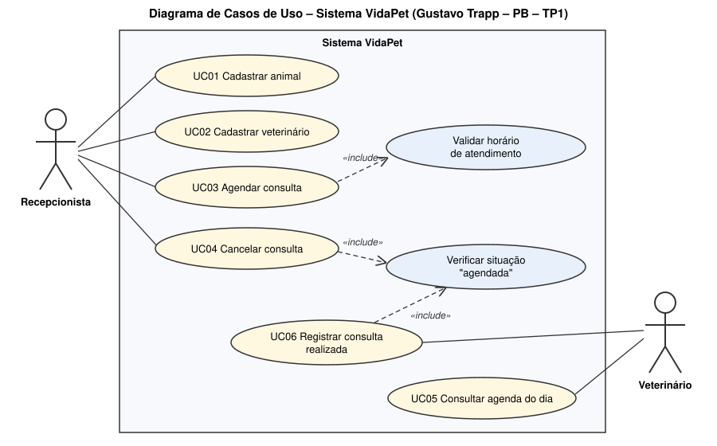

# Especificação de Casos de Uso – Sistema VidaPet

**Aluno:** Gustavo Trapp
**Disciplina:** Projeto de Bloco (PB) – TP1

## 1. Diagrama de casos de uso

Fonte editável do diagrama (PlantUML): `docs/diagrama-casos-de-uso.puml`.

Relacionamentos `<<include>>`:

- **UC03 Agendar consulta** inclui **Validar horário de atendimento** (RN01, RN03); o conflito de agenda (RN02) é verificado no passo 8.
- **UC04 Cancelar consulta** e **UC06 Registrar consulta realizada** incluem **Verificar situação "agendada"** (RN04, RN05).

## 2. Lista de casos de uso

| ID | Caso de uso | Ator principal | Detalhado abaixo |
|---|---|---|---|
| UC01 | Cadastrar animal | Recepcionista | Sim (resumido) |
| UC02 | Cadastrar veterinário | Recepcionista | Sim (resumido) |
| UC03 | Agendar consulta | Recepcionista | **Sim (completo)** |
| UC04 | Cancelar consulta | Recepcionista | **Sim (completo)** |
| UC05 | Consultar agenda do dia | Veterinário | **Sim (completo)** |
| UC06 | Registrar consulta realizada | Veterinário | **Sim (completo)** |

---

## UC03 – Agendar consulta

| Item | Descrição |
|---|---|
| **Ator principal** | Recepcionista |
| **Objetivo** | Marcar uma consulta de 30 minutos para um animal com um veterinário. |
| **Requisitos** | RF07, RF08, RF09, RF10 |
| **Pré-condições** | Existe ao menos um animal e um veterinário cadastrados. |
| **Pós-condição (sucesso)** | Consulta registrada com situação "agendada". |

**Fluxo principal**

1. A recepcionista escolhe a opção "Agendar consulta".
2. O sistema lista os animais cadastrados.
3. A recepcionista informa o número do animal.
4. O sistema lista os veterinários cadastrados.
5. A recepcionista informa o número do veterinário.
6. A recepcionista informa a data (dd/mm/aaaa) e o horário (hh:mm).
7. O sistema valida a data e o horário (include *Validar horário de atendimento*): data existente, dia útil, horário entre 08:00 e 17:30 em múltiplos de 30 minutos, não estar no passado.
8. O sistema verifica que o veterinário não possui outra consulta agendada no mesmo dia e horário.
9. O sistema registra a consulta como "agendada" e exibe o número da consulta.

**Fluxos alternativos**

- **FA1 – Não há animal ou veterinário cadastrado (pré-condição não satisfeita)** — no passo 2 ou 4, o sistema informa "Cadastre ao menos um animal e um veterinário antes de agendar" e retorna ao menu.
- **FA2 – Número de animal/veterinário inexistente** — nos passos 3 ou 5, o sistema exibe "Opção inválida" e retorna ao menu.
- **FA3 – Data inválida, fim de semana ou fora do expediente** — no passo 7, o sistema informa o motivo ("data inexistente", "consultas só de segunda a sexta", "horário deve ser entre 08:00 e 17:30, de 30 em 30 minutos") e a consulta não é criada.
- **FA4 – Data/horário no passado** — no passo 7, o sistema informa "Não é possível agendar em data/horário que já passou" e a consulta não é criada.
- **FA5 – Conflito de horário do veterinário** — no passo 8, o sistema informa "O veterinário já possui consulta agendada neste horário" e a consulta não é criada.

---

## UC04 – Cancelar consulta

| Item | Descrição |
|---|---|
| **Ator principal** | Recepcionista |
| **Objetivo** | Cancelar uma consulta que não acontecerá. |
| **Requisitos** | RF11, RF15 |
| **Pré-condições** | Existe ao menos uma consulta cadastrada. |
| **Pós-condição (sucesso)** | Consulta com situação "cancelada"; o horário fica livre para novo agendamento. |

**Fluxo principal**

1. A recepcionista escolhe "Cancelar consulta".
2. O sistema lista as consultas com número, data, horário, animal, veterinário e situação.
3. A recepcionista informa o número da consulta.
4. O sistema verifica que a consulta está "agendada" (include *Verificar situação "agendada"*).
5. O sistema altera a situação para "cancelada" e confirma a operação.

**Fluxos alternativos**

- **FA1 – Nenhuma consulta cadastrada** — no passo 2, o sistema informa "Nenhuma consulta cadastrada" e retorna ao menu.
- **FA2 – Número de consulta inexistente** — no passo 3, o sistema exibe "Consulta não encontrada".
- **FA3 – Consulta já realizada ou já cancelada** — no passo 4, o sistema informa "Só é possível cancelar consultas com situação AGENDADA (situação atual: X)" e nada é alterado.

---

## UC05 – Consultar agenda do dia

| Item | Descrição |
|---|---|
| **Ator principal** | Veterinário |
| **Objetivo** | Ver as consultas de um dia, em ordem de horário. |
| **Requisitos** | RF12 |
| **Pré-condições** | O veterinário está cadastrado (identifica-se pelo CRMV). |
| **Pós-condição** | Nenhuma alteração nos dados. |

**Fluxo principal**

1. O veterinário escolhe "Minha agenda do dia".
2. O sistema solicita o CRMV.
3. O veterinário informa o CRMV e a data desejada (Enter = hoje).
4. O sistema exibe as consultas do veterinário naquela data, ordenadas por horário, com animal, espécie, tutor e situação.

**Fluxos alternativos**

- **FA1 – CRMV não cadastrado** — no passo 3, o sistema informa "Veterinário não encontrado" e retorna ao menu.
- **FA2 – Nenhuma consulta na data** — no passo 4, o sistema informa "Nenhuma consulta para esta data".
- **FA3 – Data inválida** — no passo 3, o sistema informa "Data inválida" e retorna ao menu.

---

## UC06 – Registrar consulta realizada

| Item | Descrição |
|---|---|
| **Ator principal** | Veterinário |
| **Objetivo** | Concluir a consulta e registrar as observações do atendimento. |
| **Requisitos** | RF13, RF14 |
| **Pré-condições** | Consulta existe, está "agendada" e pertence ao veterinário. |
| **Pós-condição (sucesso)** | Consulta com situação "realizada" e observações gravadas. |

**Fluxo principal**

1. O veterinário escolhe "Registrar consulta realizada".
2. O sistema solicita o CRMV e lista as consultas agendadas desse veterinário.
3. O veterinário informa o número da consulta.
4. O sistema verifica que a consulta pertence ao veterinário e está "agendada" (include *Verificar situação "agendada"*).
5. O veterinário digita as observações do atendimento.
6. O sistema altera a situação para "realizada", grava as observações e confirma.

**Fluxos alternativos**

- **FA1 – CRMV não cadastrado** — no passo 2, o sistema informa "Veterinário não encontrado".
- **FA2 – Consulta de outro veterinário** — no passo 4, o sistema informa "Apenas o veterinário da consulta pode registrá-la como realizada" e nada é alterado.
- **FA3 – Consulta cancelada ou já realizada** — no passo 4, o sistema informa "Só consultas AGENDADAS podem ser marcadas como realizadas".
- **FA4 – Observação vazia** — no passo 5, o sistema registra "Sem observações".

---

## UC01 – Cadastrar animal (resumido)

**Ator:** Recepcionista. **Fluxo principal:** informa nome, espécie, idade, nome e telefone do tutor → sistema valida → animal cadastrado com um número.
**FA1 – Espécie inválida:** espécie diferente de cão/gato → mensagem de erro, cadastro não realizado.
**FA2 – Idade inválida:** idade não numérica ou negativa → mensagem de erro.
**FA3 – Campo obrigatório vazio:** nome, tutor ou telefone em branco → mensagem de erro.

## UC02 – Cadastrar veterinário (resumido)

**Ator:** Recepcionista. **Fluxo principal:** informa nome e CRMV → sistema valida → veterinário cadastrado.
**FA1 – CRMV duplicado:** já existe veterinário com o CRMV → mensagem de erro.
**FA2 – Campo vazio:** nome ou CRMV em branco → mensagem de erro.
